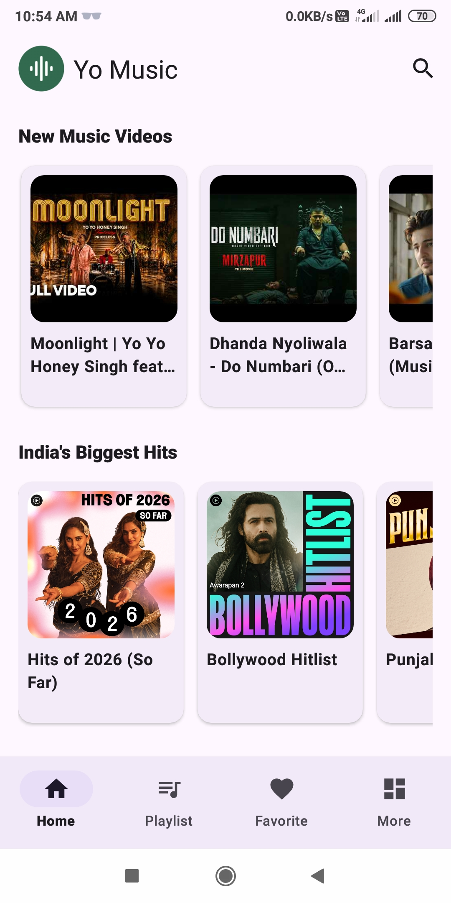
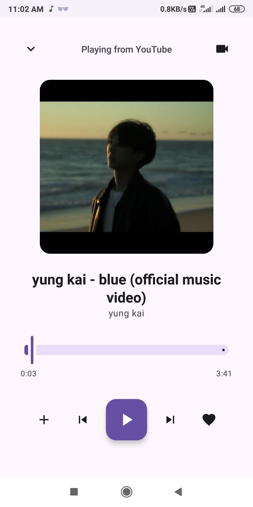
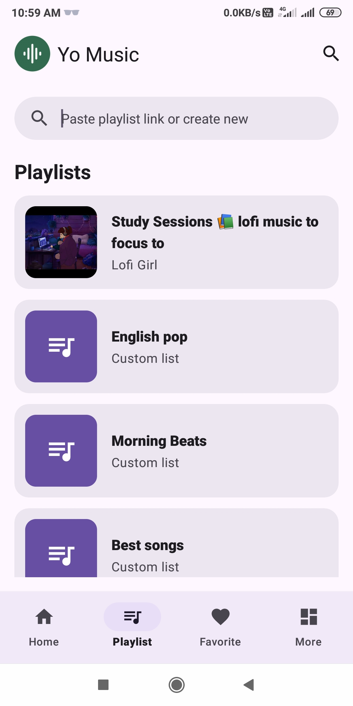
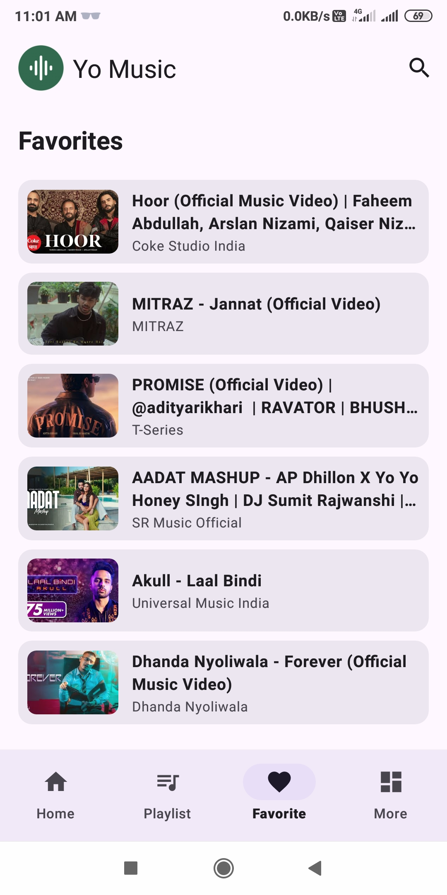

<p align="center">

</p>

<div align="center">
  <h1>Yo Music</h1>
</div>
<p align="center">Turn YouTube Videos into Your Personal Music Player — Rebuilt to be Fully Native</p>

<p align="center">


<a href="https://opensource.org/licenses/"></a>
</p>

<p align="center">


</p>

<br />

**Yo Music (Native)** is a premium, high-quality, and clean native Android client for YouTube Music. 

This repository is a **complete native Java rewrite** of the original hybrid project, migrated to achieve optimal background playback stability, lock screen widget sync, fluid UI transitions, and significantly reduced memory usage.

> [NOTE]  
> This project is a native conversion of the original React/Capacitor hybrid project: [iamvkr047/yomusic](https://github.com/iamvkr047/yomusic/tree/v1).

---

## 🌟 Key Native Enhancements

- ⚡ **Performance & Resource Optimization**: Drastically smaller RAM and battery usage compared to hybrid Webview containers.
- 📻 **System Media Notification Integration**: Native lock screen widget integration using standard Android `MediaSessionCompat` (`androidx.media`) displaying real-time title, author, and dynamic high-res album art.
- 📂 **Permission-less SAF Backup/Restore**: Import and export your favorites and custom playlists locally via JSON-based backup files using Android's Storage Access Framework.

---

## Features

### 🎵 Explore Latest Music
- Browse trending and popular music dynamically scraped from YouTube Music.
- Search with autocomplete suggestions and view paginated video/playlist results.
- Import YouTube playlists or organize local custom playlists.

### 🎧 Background Playback
- Continuous audio streaming even with the screen off or the app in the background.

### 🌷 Material 3 Design
- Sleek and minimal mobile-first user interface implementing Material 3 widgets.
- Persistent Light and Dark theme toggling.

### 🌐 Region Based Feeds
- Select from 108 regions/countries to instantly personalize your local home feed.

---

## 🔽 Download

Get the compiled application packages on GitHub releases.

> [IMPORTANT NOTE]: Backup your data before installing v2. 

| Download latest Releases v2 |
| -------------------------------------------------------------------------------------------------- |
| [](https://github.com/iamvkr047/yomusic/releases) |

| Download v1 |
| -------------------------------------------------------------------------------------------------- |
| [](https://github.com/iamvkr047/yomusic/releases/tag/v1.3.0) |

---

## 📸 Screenshots

<table>
  <tr>
    <td align="center" width="50%">
      
      <br/>
      <b>Home Feed</b>
      <br/>
      <sub>Trending content and suggestions</sub>
    </td>
    <td align="center" width="50%">
      
      <br/>
      <b>Full Player</b>
      <br/>
      <sub>Immersive playback experience</sub>
    </td>
  </tr>
  <tr>
    <td align="center" width="50%">
      
      <br/>
      <b>Playlists</b>
      <br/>
      <sub>Custom and YouTube playlists</sub>
    </td>
    <td align="center" width="50%">
      
      <br/>
      <b>Favorites</b>
      <br/>
      <sub>Your Liked Songs in one place</sub>
    </td>
  </tr>
</table>

---

## 🛠️ Built With

- **Language**: Java
- **UI Framework**: Native XML Layouts & Material Design Components (M3)
- **Networking**: OkHttp
- **Image Caching**: Glide
- **Media Controls**: MediaSessionCompat
- **Underlying Engine**: WebKit WebView (YouTube Iframe background playback)

---

## 🚀 Getting Started

### Prerequisites

| Requirement                 | Version          | Download                                               |
| --------------------------- | ---------------- | ------------------------------------------------------ |
| **Android Studio**          | Ladybug or later | [Android Studio](https://developer.android.com/studio) |
| **Java JDK**                | 21 (recommended) | [OpenJDK](https://jdk.java.net/)                       |
| **Android SDK**             | API 26+          | Installed via Android Studio SDK Manager               |

### Setup & Build

1. **Clone the repository:**
   ```bash
   git clone https://github.com/iamvkr047/yomusic.git
   cd yomusic
   ```

2. **Open in Android Studio:**
   - Launch Android Studio.
   - Choose **Open an Existing Project** and select the cloned `yomusic` folder.
   - Wait for the project gradle sync to finish.

3. **Build the APK:**
   - Compile a Debug build:
     ```bash
     ./gradlew assembleDebug
     ```
   - Compile a signed Release build:
     ```bash
     ./gradlew assembleRelease
     ```

---

## 🤝 Contribution

Feel free to fork this project, submit issues, or create pull requests. Suggestions and code optimizations are always welcome!

---

## 📃 Credits

- [youtube-search-api](https://github.com/damonwonghv/youtube-search-api)
- Converted from original hybrid source: [iamvkr047/yomusic](https://github.com/iamvkr047/yomusic/tree/v1)
- Refactored with the help of AI assistants (Gemini & Claude)

---

## ℹ Disclaimer

- This project is not affiliated with, endorsed, or sponsored by YouTube or Google.
- All trademarks and brand names are the property of their respective owners and are used solely for informational purposes.
- This application does not host or redistribute any copyrighted media content; all streams are loaded from public YouTube video components.

This project is intended for **educational and personal use only**.

## 📜 License

This project is licensed under the GNU General Public License v3.0.

More at [LICENSE](/LICENSE)

---

Made with ❤️ using Native Android
